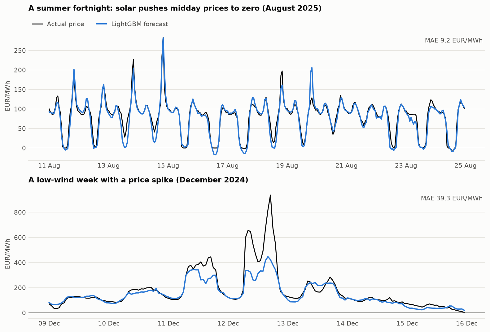
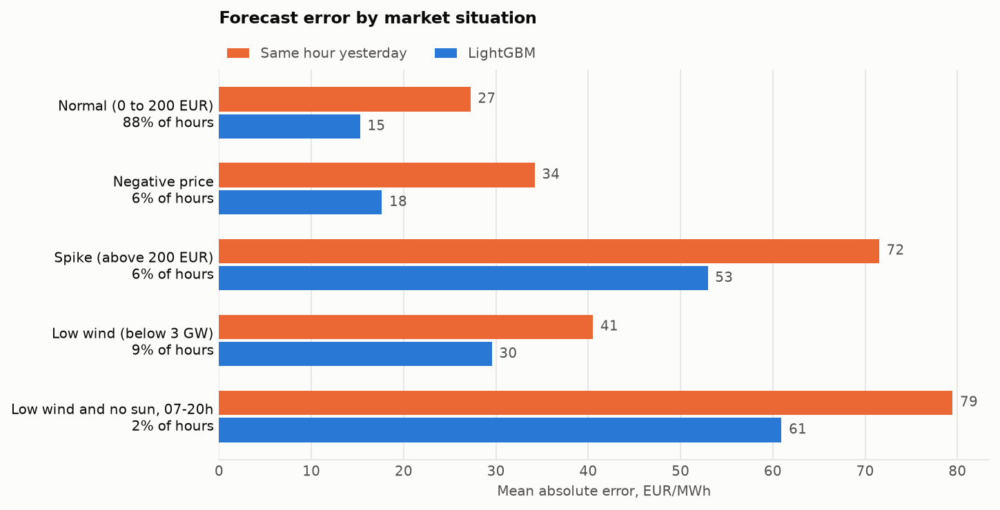
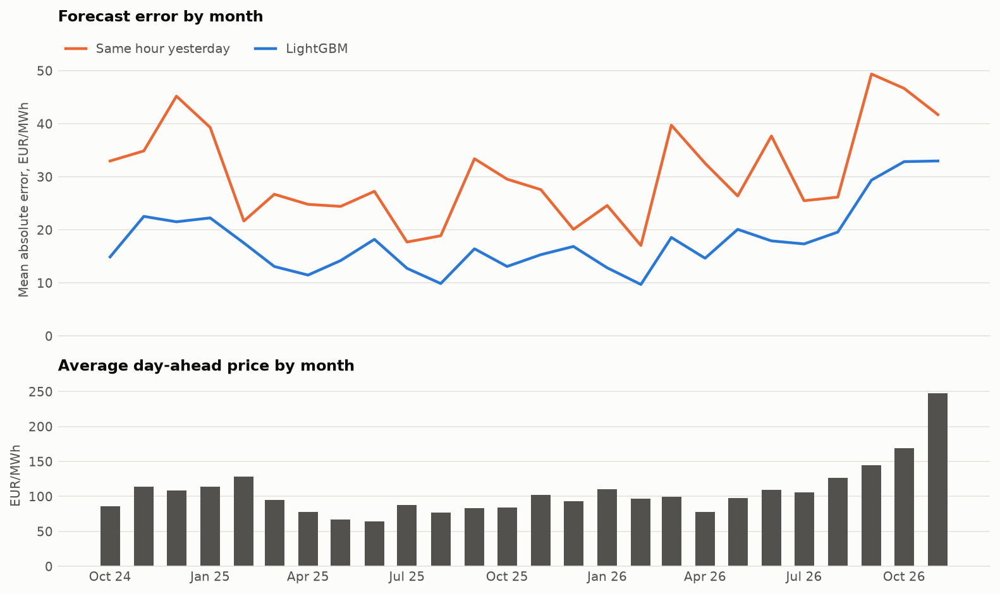
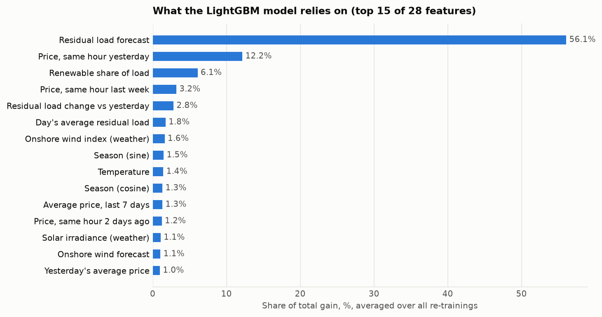
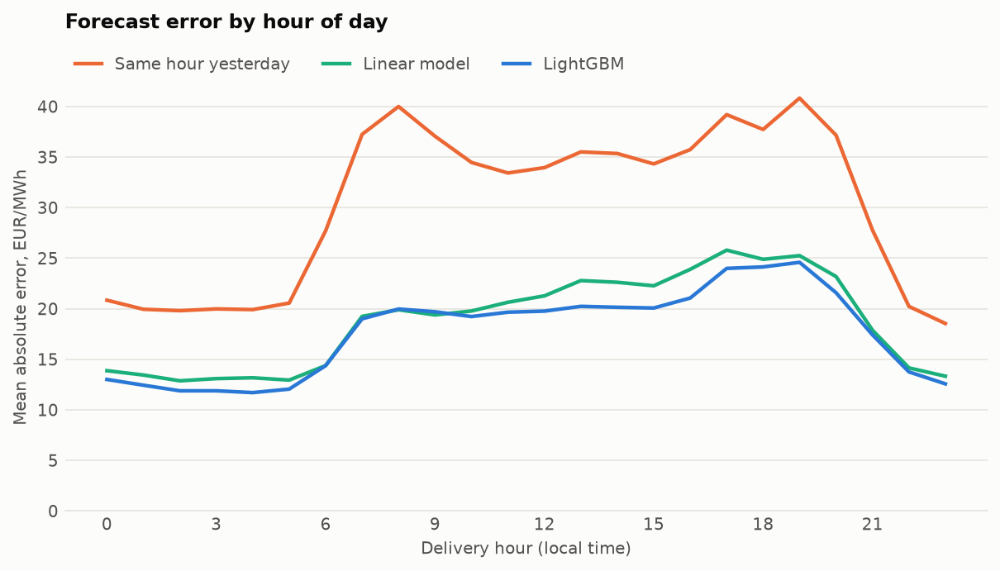
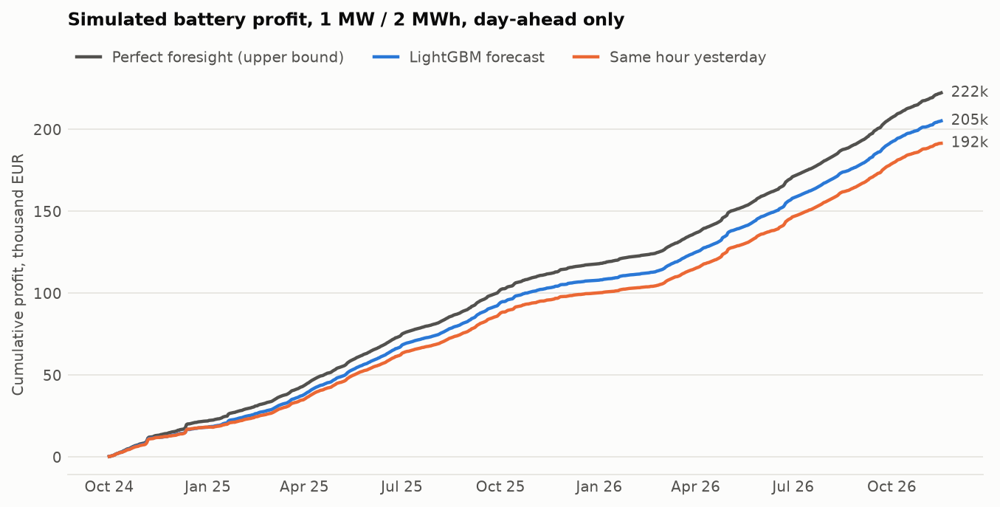

# German day-ahead power price forecasting

Forecast next-day electricity prices for the German–Luxembourg bidding zone (DE-LU)
from free fundamental data, and backtest the forecast honestly against actual
auction results.

A one-page write-up of the results is in [reports/SUMMARY.md](reports/SUMMARY.md).

## Results at a glance

Walk-forward backtest, 1 Oct 2024 to 16 Nov 2026 (777 days, 18,629 hours).
Errors in EUR/MWh; the average price over the period was 104.

| Model | MAE | RMSE | vs naive |
|---|---|---|---|
| Same hour yesterday (naive) | 30.3 | 48.2 | 100% |
| Same hour last week | 39.2 | 62.5 | 129% |
| LightGBM, calendar and price history only | 27.9 | 43.3 | 92% |
| Linear model (ridge, one per hour) | 18.8 | 30.6 | 62% |
| **LightGBM with fundamentals** | **17.7** | **29.2** | **58%** |
| Average of linear and LightGBM | 17.1 | 28.0 | 56% |
| LightGBM plus lagged fuel mix (ENTSO-E) | 17.5 | 29.1 | 58% |
| *LightGBM with TSO wind/solar forecasts (possible look-ahead)* | *15.6* | *26.8* | *51%* |



## The idea in one paragraph

Every day at 12:00 German time, the day-ahead auction sets a price for each period
of the following day. The price is mostly explained by **residual load**: demand
minus wind and solar output. That gap has to be filled by gas, coal and imports,
and the more expensive the last plant needed, the higher the price. So forecasting
the price is largely a matter of forecasting demand, wind and sun, using only what
was known before noon the day before.

## Setup

Requires Python 3.11+ and [uv](https://docs.astral.sh/uv/).

```bash
uv venv --python 3.12
uv pip install -e .
```

On macOS, LightGBM also needs the OpenMP runtime:

```bash
brew install libomp
```

## Running it

Run the scripts in order with `.venv/bin/python scripts/<name>.py`.

| Script | What it does | Time |
|---|---|---|
| `01_download_market.py` | Prices, load and wind/solar forecasts and actuals from SMARD | 2 min first run |
| `02_download_weather.py` | Archived ICON weather forecasts from Open-Meteo | 4 min first run |
| `03_validate_data.py` | Completeness and sanity checks | seconds |
| `04_download_entsoe.py` | Optional: fuel mix and cross-border flows (needs a token in `.env`) | 30+ min |
| `05_build_features.py` | Builds the hourly model table | 10 s |
| `06_run_backtest.py` | Walk-forward backtest of all models | 2–3 min |
| `07_analyze_errors.py` | Error tables and charts | seconds |
| `08_trading_signal.py` | Battery scheduling and simulated profit | seconds |
| `09_quarter_hour.py` | Extension to 15-minute products | seconds |
| `10_forecast_tomorrow.py` | Live forecast for the next delivery day | seconds |
| `00_check_forecast_publication.py` | Logs whether tomorrow's TSO forecasts are published yet | seconds |

The downloads are incremental: later runs only fetch recent days. For a live
forecast, run 01, 02, 05 and 10 before noon.

## How it works, step by step

**1. Data** ([smard.py](src/powerfc/data/smard.py), [openmeteo.py](src/powerfc/data/openmeteo.py)).
Everything is stored as Parquet in `data/`, in UTC, at 15-minute resolution for
market data and hourly for weather.

**2. Wind and solar from weather** ([renewables.py](src/powerfc/renewables.py)).
For each hour, pick the freshest weather forecast that existed at gate closure.
Convert wind speed to a share of full output with a power curve. Then learn, on the
previous 60 days only, how many MW each of 14 weather points stands for, and
re-learn it every day.

**3. Features** ([features.py](src/powerfc/features.py)). One row per delivery hour:

- residual load = load forecast − wind − solar, and the renewable share of load;
- its change against yesterday and last week, and the day's average, peak and low;
- prices of the same hour 1, 2 and 7 days ago, yesterday's average, low and high;
- hour, weekday, weekend, public holiday, season.

**4. Models** ([models.py](src/powerfc/models.py)). Two naive baselines, a linear
model with one regression per hour, and LightGBM. Settings are defaults and were
not tuned on the test period.

**5. Backtest** ([backtest.py](src/powerfc/backtest.py)). Walk-forward: train on
everything before a week, forecast that week, move on. No random split.

**6. Error analysis** ([analysis.py](src/powerfc/analysis.py)) and
**7. trading use** ([trading.py](src/powerfc/trading.py)): see below.

## Two rules that keep the backtest honest

**1. No look-ahead.** To forecast delivery day D, only data available before
12:00 local time on D-1 may be used.

- *Weather:* archived **forecasts**, never observed weather. Open-Meteo stores what
  the model predicted 24 h and 48 h before each hour. A 24 h-ahead value is used
  only if its model run would have been published before gate closure (allowing
  4 hours); otherwise the 48 h-ahead value is used. In practice that means the
  24 h forecast for hours up to 08:00 and the 48 h forecast after.
- *TSO wind and solar forecasts:* SMARD does not record when these were published.
  On the day this was built, tomorrow's load forecast was online by 10:20 but
  tomorrow's wind and solar forecasts were still missing at 11:27, half an hour
  before gate closure. They are therefore excluded from the headline model and
  used only in one labelled comparison run.
- *Prices:* day D-1's prices are known (that auction cleared a day earlier), so
  lags of one day and more are allowed.
- *Metered generation:* used with a two-day delay, because the latest day is
  incomplete at gate closure.
- *Outages:* not used. ENTSO-E only returns the latest revision of each outage
  message, so a point-in-time history cannot be rebuilt.

**2. Time is stored in UTC.** German local time has one 23-hour and one 25-hour day
per year. Everything is stored in UTC and converted to `Europe/Berlin` only for
calendar concepts such as "delivery day" or "hour of day". "Same hour yesterday" is
looked up by local clock time, not by subtracting 24 hours.

The auction moved from hourly to 15-minute products on delivery day 1 October 2025.
The main model forecasts the hourly average, which exists for the whole history;
`09_quarter_hour.py` adds the pattern of the four quarters within each hour.

## When the model fails



- **Price spikes.** Hours above 200 EUR/MWh are 6% of the sample and 18% of the
  total error. The model under-forecasts them by 31 EUR on average.
- **Low wind.** Error doubles when wind output is below 3 GW, and reaches 61 EUR in
  low-wind hours without sun.
- **Negative prices** are forecast about as well as normal hours (18 vs 15 EUR).
- **Changes in price level.** From September 2026 the average price rose sharply
  and the error doubled. The model has no fuel or carbon price input.



Weather forecast errors matter less than expected: the price error is 16 EUR when
the residual-load forecast is nearly right and 20 EUR when it misses by over 6 GW.




## Trading use: a battery in the day-ahead auction

A 1 MW / 2 MWh battery is scheduled each day with a small linear programme on the
forecast prices and settled at actual prices.

| Schedule based on | EUR per MW per year | Share of perfect foresight |
|---|---|---|
| Perfect foresight | 104,500 | 100% |
| Average of linear and LightGBM | 97,700 | 94% |
| LightGBM | 96,500 | 92% |
| Same hour yesterday | 90,000 | 86% |

Assumptions: price taker, all orders filled, 90% efficiency, no fees or
degradation, battery empty at the start of each day, hourly products only.



## Data sources

| Source | What we take | Access |
|---|---|---|
| [SMARD](https://www.smard.de) (Bundesnetzagentur) | Day-ahead prices, load forecast and actual, wind and solar forecast and actual | Free, no token, CC BY 4.0 |
| [Open-Meteo](https://open-meteo.com) Previous Runs API | DWD ICON forecasts of 100 m wind speed, irradiance and temperature at 14 points | Free for non-commercial use |
| [ENTSO-E Transparency Platform](https://transparency.entsoe.eu) | Generation by fuel, cross-border flows | Free, personal API token |

Fuel and carbon prices are not included: there is no official free API for TTF gas
or EUA carbon.

## Limitations

- No fuel, carbon or outage inputs.
- The publication time of the TSO load forecast is assumed from regulation and one
  day's observation, not proven for the whole history.
- 14 weather points and a single weather model.
- The wind power-curve exponent was chosen by comparing a few values on the full
  history.
- The battery simulation ignores market impact, fees, degradation, and the
  intraday and balancing markets.

## Project layout

```
src/powerfc/
  config.py            dates, paths, market rules
  timeutils.py         delivery days, gate closure, 23/25-hour days
  store.py             local Parquet store
  data/                downloaders: smard.py, openmeteo.py, entsoe_client.py
  renewables.py        weather forecast -> wind and solar MW
  features.py          the model table and the allowed feature sets
  models.py            naive, ridge, LightGBM
  backtest.py          walk-forward loop and metrics
  analysis.py          error breakdowns
  trading.py           battery scheduling
  quarter_hour.py      15-minute extension
  plots.py             charts
scripts/               numbered entry points, run in order
reports/               result tables, charts, summary
data/                  downloaded Parquet files (git-ignored)
```

The Parquet files can be queried with SQL using [DuckDB](https://duckdb.org):

```sql
SELECT date_trunc('month', time_utc) AS month, avg(price) AS avg_price
FROM 'data/market_15min.parquet'
GROUP BY 1 ORDER BY 1;
```
